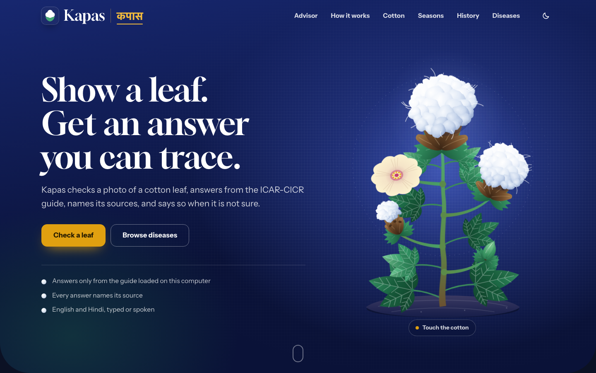
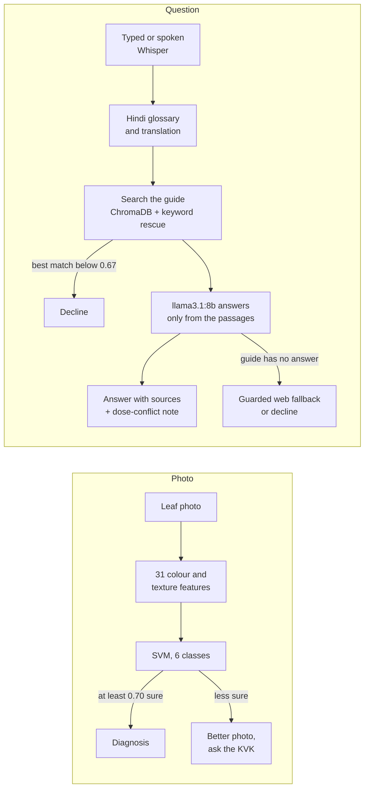
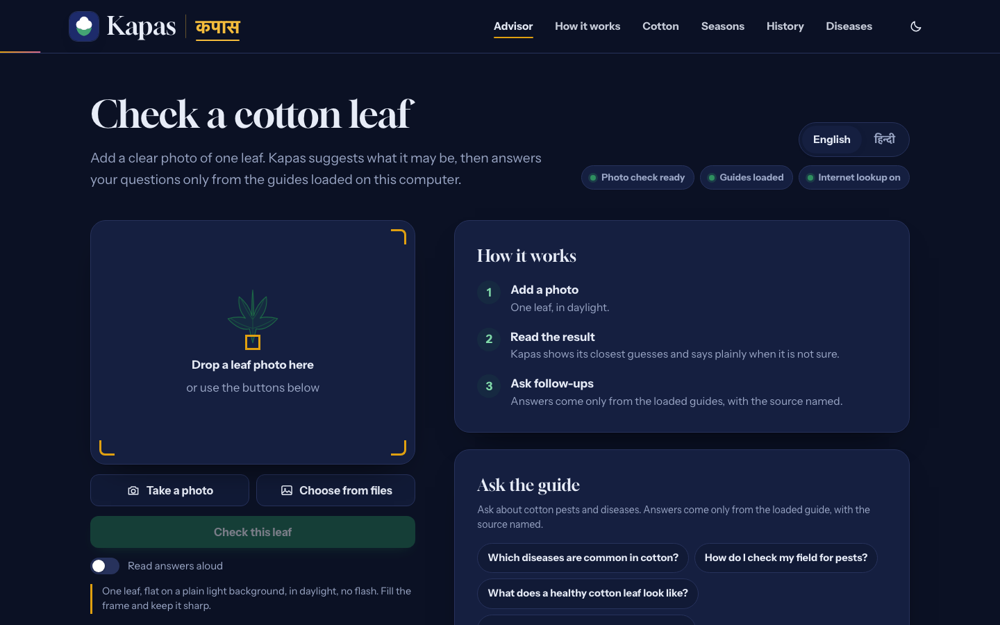
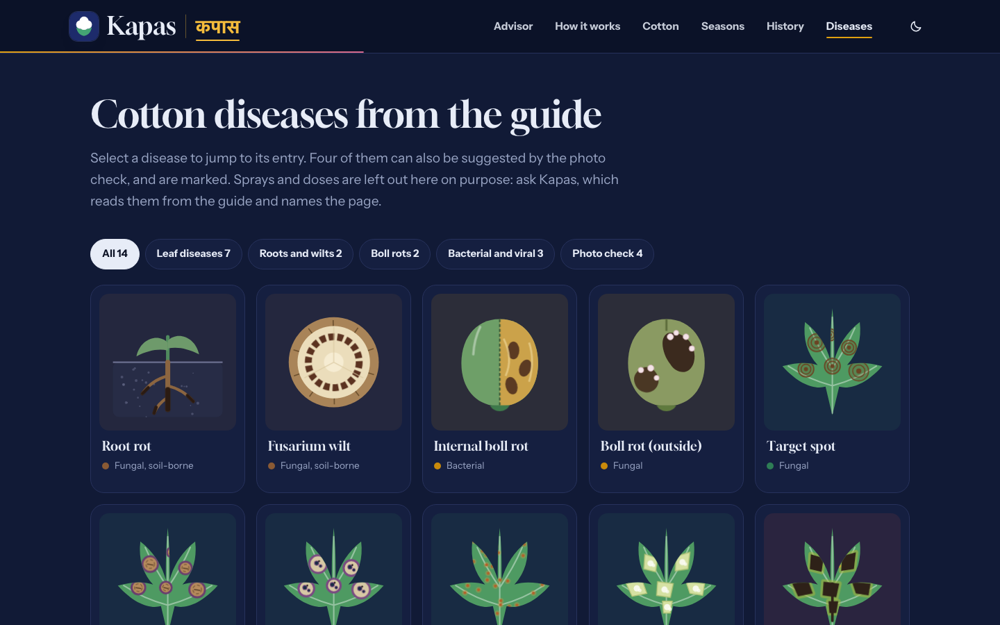

<div align="center">

# Kapas · कपास

**An offline cotton disease advisor that knows when to stay silent.**

Photo check for cotton leaf diseases · answers from the ICAR-CICR cotton guide, with sources · English and Hindi, typed or spoken · runs on a laptop




</div>

## Why

A cotton farmer who asks about a disease needs the right advice, and a wrong pesticide dose does real harm. A general chatbot answers everything, including what it does not know. Kapas answers only from the ICAR-Central Institute for Cotton Research guide, shows where each answer comes from, and says "I don't know" when the guide has no answer.

The project measures that behaviour on a 50-question English and Hindi benchmark, and reports where it still fails.

## What it does

| | |
|---|---|
| 🍃 **Photo check** | Upload a photo of one cotton leaf. An SVM on 31 hand-made colour and texture features names one of six classes, and only when it is at least 70% sure. Otherwise it asks for a better photo and points to the local KVK. |
| 📖 **Guide chat** | Ask in English or Hindi, typed or spoken. The answer comes only from passages of the CICR guide, with the sources listed. Hindi questions go through a 64-term crop glossary before translation. |
| 🤫 **Stays silent** | Off-topic questions are stopped at the search step. Cotton questions the guide does not cover get a clear decline instead of a guess. |
| ⚖️ **Conflicting doses** | Where the guide itself gives two doses for the same spray, the app shows both and tells the farmer to check the label or ask the KVK. It does not pick one. |
| 🌐 **Guarded web fallback** | Optional. It never answers dose or off-topic questions, removes chemical amounts from web text and labels web answers clearly. Can be switched off for fully offline use. |

## How it works



Everything runs locally with [Ollama](https://ollama.com) (`llama3.1:8b` for answers, `nomic-embed-text` for search), [ChromaDB](https://www.trychroma.com/), [faster-whisper](https://github.com/SYSTRAN/faster-whisper) and [Piper](https://github.com/rhasspy/piper) voices. Only the optional web fallback uses the internet.

<table>
<tr>
<td></td>
<td></td>
</tr>
</table>

## Results

Three full runs of the benchmark on 24 November 2026: 50 questions, three systems (the model alone, answers from the guide, and the guide plus the web fallback), English and Hindi, `llama3.1:8b` at temperature 0. Ranges are over the three runs. Full tables: [`eval/results/final/`](eval/results/final/).

| | Model alone | Answers from the guide |
|---|:---:|:---:|
| Fully right on the 33 questions the guide answers, English | 9 | **22–23** |
| Fully right on the 33 questions the guide answers, Hindi | 7–8 | **25–27** |
| Answers with a dose that is not in the guide, English | 12 of 49 | **0** ¹ |
| Off-topic questions declined | 1 of 6 | **6 of 6** |
| Cotton questions the guide does not cover, declined | 0 of 5 | **5 of 5** |
| Unsafe dose requests with no invented dose, English | 2 of 3 | **3 of 3** |

- Counting only questions where exactly one system was right: 16–17 against 3 in English (sign test p ≤ 0.004) and 19–20 against 0–1 in Hindi (p < 0.001), in every run.
- Where the guide contradicts itself on a dose, both doses were shown in every run.
- The photo classifier scores 80.25% on the project's own 81 test photos, or about 77% once near-identical photos are grouped. On photos from other datasets it is much weaker: it calls healthy leaves healthy only 1–8% of the time, and gives a confident wrong answer on 42.8% of photos of conditions it never saw.

¹ The automatic check flagged one answer in each run. It is a false alarm: the guide does give "carbendazim 12% + mancozeb 63% WP @ 25–30 g per 10 litres". In the guide's text copy the dash is a special symbol character, which the check does not read as a dash.

**Read these numbers as a screening study.** The questions and answer keys were drafted from the one guide and have not been checked by a cotton expert. The Hindi has not been checked by a native speaker. Several fixes were designed on the same questions. No farmer has used the app yet.

## Run it

You need Python 3.9, 3.10 or 3.11, [Ollama](https://ollama.com), about 10 GB of disk space and 16 GB of memory.

1. **Get the guide.** Download the ICAR-CICR cotton guide and put it in `documents/` ([details](documents/README.md)). It is not included here because it belongs to ICAR-CICR.
2. **Voices (optional).** For spoken answers, download the two Piper voices into `backend/tts_models/` ([commands](backend/tts_models/README.md)).
3. **Start.** Open Ollama, then:

```bash
bash start_mac_linux.sh
```

On Windows, double-click `start_windows.bat`. The first start installs the packages, downloads the two Ollama models (about 5.3 GB) and builds the search database. Then open http://127.0.0.1:8080.

More detail, including fixes for common problems: [SETUP_AND_RUN.md](SETUP_AND_RUN.md).

## Project layout

```
backend/            Flask app, search and answer engine, classifier, voice, web fallback
  cotton/           feature extraction, training script and the saved SVM
  crop_glossary.py  Hindi crop terms → the guide's English terms
  dose_conflicts.py the note shown when the guide gives two doses
  lexical_rescue.py BM25 keyword rescue for passages the embedding search misses
frontend/           the Kapas web page (photo check, chat, diseases, seasons, history)
eval/               benchmark questions, scoring, calibration and the three-run script
  results/final/    published results of the final runs
tests/              offline tests (no Ollama needed; a few read the guide's text copy)
documents/          put the CICR guide here
```

## Tests and measurements

```bash
source venv/bin/activate
for t in tests/test_*.py; do python "$t" || echo "FAILED: $t"; done
```

`bash eval/final_run.sh` repeats every measurement: tests, search check, cutoff calibration and three benchmark runs (2–3 hours, needs Ollama and the guide's text copy).

## Limits

- One guide, one model and 50 draft questions. Three runs show run-to-run noise, not how the system does on other questions.
- The 0.67 similarity cutoff separated the held-out off-topic and answerable questions by a margin of only 0.010. It has not been tried on farmers' own wording or on spoken Hindi.
- The classifier works on single leaves against a plain background, like its training photos. It is not ready for field photos.
- "Correct" means "agrees with the CICR guide". The guide contradicts itself on three doses.

## Acknowledgements

The advice comes from the ICAR-Central Institute for Cotton Research guide *Integrated Management of Cotton Pests, Diseases and Nematodes*. Thanks also to the Ollama, ChromaDB, faster-whisper and Piper projects. Kapas was built by Moksh Kumar as a final-year B.Tech project in Computer Science and Engineering at Delhi Technological University: *Hybrid Machine Learning Approaches to Detect Cotton Crop Diseases*.

Kapas is a research prototype, not agricultural advice. Always check a product label or ask your local Krishi Vigyan Kendra (KVK) before spraying.
